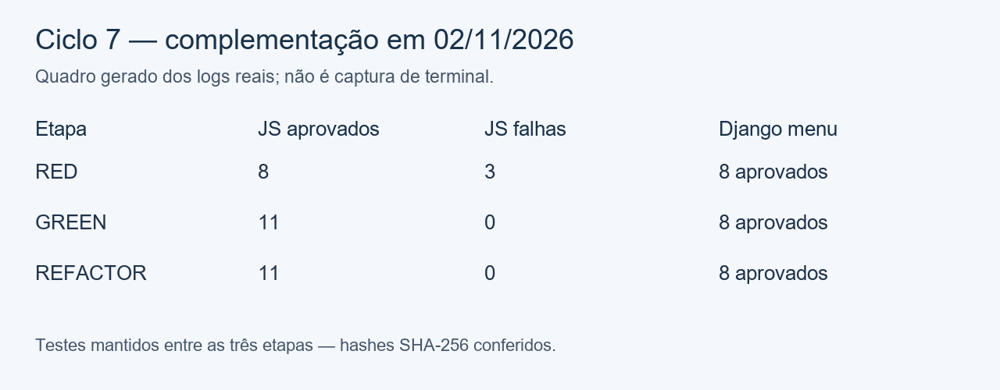

# Ciclos 7 e 8 — complementação: falhas na cópia de URLs

Responsável por esta complementação: Maria Eduarda Rodrigues Morais, conta GitHub Duda-RM. Execuções reais em **02/11/2026, America/Sao_Paulo**; os metadados registram horário UTC, que pode corresponder ao dia seguinte.

## Origem e ordem real

Os números 7 e 8 identificam a complementação de duas posições ausentes no relatório da equipe. **Estes ciclos foram executados agora, depois dos ciclos 9 a 12. Não são uma reconstrução de execuções antigas nem trabalho atribuído a outro integrante.** A base é `04af44444ba5a616ff09ff1037c42d0697869540`, da branch `tdd-cycles-11-12`, que já contém a cópia de URLs e a abertura com confirmação. A branch desta contribuição é `tdd-cycles-7-8`.

A cópia existente retornava silenciosamente quando o servidor falhava e rejeitava a promessa do manipulador do clique em erros de rede ou de acesso ao clipboard. Agora o usuário recebe uma mensagem que distingue falha de carregamento de falha da área de transferência e pode tentar novamente. As regras de seleção e de abertura dos ciclos anteriores foram preservadas.

## Preparação

O runner `scripts/run_tdd_copy_errors.py` reaproveita a estratégia de testes já usada pela equipe: executa o componente real em `vm.SourceTextModule`, com doubles apenas nos limites de navegador, e executa testes Django em processo isolado com SQLite em memória, Huey temporário e hasher MD5. Nenhuma configuração de produção foi alterada.

Baseline registrado: **8 testes JavaScript e 111 testes Django aprovados**. Não foram feitas chamadas reais à rede, à área de transferência ou a sites externos.

## Ciclo 7 — falhas ao buscar as URLs

Três testes foram adicionados antes da implementação:

- `supplemental cycle 7: an HTTP error notifies the user without copying the error body`;
- `supplemental cycle 7: a network rejection is handled and a later retry can copy`;
- `supplemental cycle 7: a failed response body read does not reach the clipboard`.

**RED:** os três testes falharam: HTTP 500 não mostrava mensagem, a rejeição de rede escapava do manipulador e uma falha em `response.text()` também escapava. Os 8 testes JavaScript anteriores e os 8 testes Django de menu passaram.

**GREEN:** a requisição e a leitura do corpo foram protegidas; respostas HTTP sem sucesso interrompem a cópia e todas essas falhas mostram `Could not load URLs. Please try again.`. Os **11 testes JavaScript e 8 de menu passaram**.

**REFACTOR:** a requisição POST e a validação da resposta foram extraídas para `fetchSelectedUrls(form)`. Os mesmos testes foram executados sem alteração e continuaram passando: **11 + 8**.

| Etapa | Commit |
| --- | --- |
| RED | [34c764c](https://github.com/xLucasMelo/linkding/commit/34c764c) |
| GREEN | [d976339](https://github.com/xLucasMelo/linkding/commit/d976339) |
| REFACTOR | [0a90b3e](https://github.com/xLucasMelo/linkding/commit/0a90b3e) |



## Ciclo 8 — falhas ao gravar na área de transferência

Dois testes foram adicionados antes da correção:

- `supplemental cycle 8: denied clipboard permission is handled and a later retry can copy`;
- `supplemental cycle 8: an unavailable clipboard API produces an actionable message`.

**RED:** os dois testes falharam, um com rejeição `NotAllowedError` e o outro com `TypeError` quando `navigator.clipboard` não existe. Os **11 testes JavaScript anteriores e os 8 de menu passaram**.

**GREEN:** o acesso ao clipboard foi protegido e passou a mostrar `Could not copy URLs to the clipboard. Check clipboard permissions and try again.`. A ação pode ser repetida depois de resolver o problema. Os **13 testes JavaScript e 8 de menu passaram**.

**REFACTOR:** a cópia completa foi extraída para `copySelectedUrls`, mantendo o manipulador principal responsável pelo encaminhamento de ações. Os mesmos **13 + 8 testes passaram**, sem alterar os testes do ciclo.

| Etapa | Commit |
| --- | --- |
| RED | [d5815c2](https://github.com/xLucasMelo/linkding/commit/d5815c2) |
| GREEN | [f36a535](https://github.com/xLucasMelo/linkding/commit/f36a535) |
| REFACTOR | [d158828](https://github.com/xLucasMelo/linkding/commit/d158828) |


## Validação final e reprodução

Após a formatação, passaram **13 testes JavaScript e 111 testes Django** dos três arquivos de ações, listagem principal e arquivados. Os oito testes de menu são parte dos 111 e não são contados novamente. Essa execução não representa a suíte inteira do projeto.

A compilação Rollup (`npm run build-js`), o Prettier dos dois arquivos JavaScript alterados, o Ruff do runner e `git diff --check` foram aprovados.

```sh
npm ci --ignore-scripts --no-audit --no-fund
npm run test:bulk-actions
python scripts/run_tdd_copy_errors.py final --suite regression
npm run build-js
npx prettier --check bookmarks/frontend/components/bookmark-page.js bookmarks/frontend/tests/bookmark-page.test.cjs
ruff check scripts/run_tdd_copy_errors.py
```

O runner grava a saída real e metadados em `output/tdd-cycles-7-8/`. Para reproduzir um RED, use um checkout separado do commit RED correspondente; o rótulo passado ao runner só identifica os arquivos de log e não força falhas. Os hashes SHA-256 confirmam que os testes foram preservados entre RED, GREEN e REFACTOR dentro de cada ciclo. A formatação posterior pode alterar apenas a representação de fim de linha do arquivo.

Os metadados registram o HEAD existente antes do commit da etapa: cada execução ocorreu com a mudança da etapa ainda no working tree, antes de seu commit. O histórico e os hashes permitem identificar esse estado. Os quadros PNG apresentam dados dos logs; não simulam capturas de terminal. Caminhos locais e espaços finais foram normalizados nas cópias públicas dos logs; os originais ficam em `output/`.

Código completo: [componente](../../../bookmarks/frontend/components/bookmark-page.js), [testes JavaScript](../../../bookmarks/frontend/tests/bookmark-page.test.cjs) e [runner](../../../scripts/run_tdd_copy_errors.py).

## Limites e uso de IA

Os testes são unitários e simulam HTTP, permissões e API de clipboard. Não houve teste E2E, acesso real ao clipboard, abertura real de abas nem comprovação de comportamento de pop-ups/permissões em um navegador. A alteração usa mensagens genéricas e não exibe detalhes internos das exceções ao usuário.

Houve assistência do Codex no planejamento, na implementação, nas execuções e na documentação desta complementação. Os testes, falhas e aprovações descritos foram executados de fato, em sequência; não foram retrodatados. A autoria declarada é a de Maria Eduarda nesta contribuição complementar.
