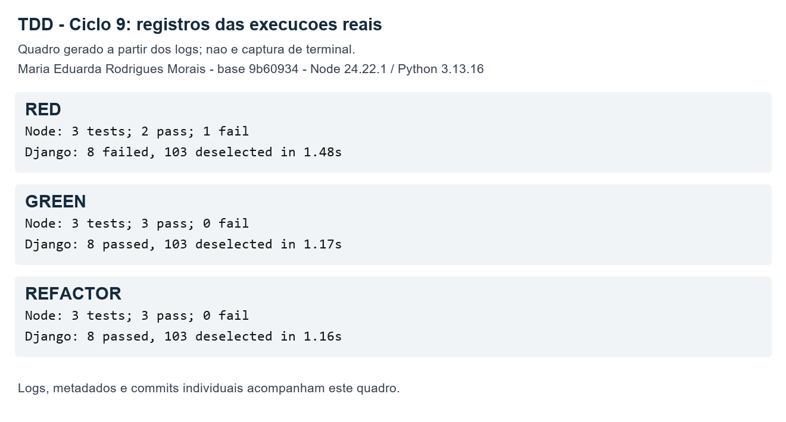

# TDD — ciclos 9 e 10: abrir URLs selecionadas

Responsável: Maria Eduarda Rodrigues Morais, conta GitHub Duda-RM. Execuções reais em 31/10/2026. Issue de referência: [#1345 — batch open/copy URLs](https://github.com/sissbruecker/linkding/issues/1345).

Base: `xLucasMelo/linkding`, commit `9b609342fcdeb98d2dd878f8946d8048cd224928`, que já contém a integração de cópia de URLs na interface. Branch: `codex/tdd-cycles-9-10`. A numeração 9/10 segue a quinta posição na ordem da equipe após a mudança para dois ciclos por integrante em uma única issue.

## Comportamento entregue

O menu de ações em lote inclui **Open URLs (this page)**. A ação abre os favoritos marcados da página atual, na ordem de exibição, sem enviar o formulário, sem consultar a rede e sem alterar a área de transferência. Usa `window.open` com `_blank` e `noopener,noreferrer` dentro do manipulador do clique, antes de qualquer `await`.

Ao escolher essa ação, a opção de seleção entre páginas é ocultada e desmarcada. Ao voltar a uma ação existente, essa seleção volta a ficar disponível quando todos os itens visíveis estão marcados. O rótulo informa o escopo da abertura. A cópia existente mantém o fluxo de requisição ao servidor e a exclusão mantém sua confirmação e submissão normal.

## Preparação e baseline

Foi criado um harness de testes unitários do componente real usando `node:test` e `vm.SourceTextModule`, sem dependências novas. O módulo real é carregado sem reescrever seu código; somente os limites de navegador (DOM mínimo, `window.open`, clipboard, formulário, fetch e a classe-base) são substituídos por doubles de teste. Os testes não abrem links externos.

Antes de implementar a abertura: **2 testes JavaScript e 111 testes Django aprovados**. Um problema de codificação do console Windows foi corrigido no runner durante a preparação, antes do baseline registrado; não foi contabilizado como RED funcional.

## Ciclo 9 — abrir um favorito

Teste: `cycle 9: opens one selected bookmark synchronously without posting or copying`.

**RED:** o teste seleciona um favorito e mantém outro desmarcado. A lista de chamadas a `window.open` era vazia, em vez de conter a URL marcada. O componente teve **1 falha e 2 aprovações**. O contrato do menu foi atualizado nos oito testes existentes de listagem principal/arquivados; os oito falharam porque a opção ainda não existia no HTML.

**GREEN:** foi adicionada a opção ao template e o tratamento da ação no componente. A implementação mínima localiza o primeiro favorito marcado, abre sua URL e interrompe a submissão. A seleção entre páginas é desativada para esta ação. Resultado: **3 testes JavaScript e 8 testes de menu aprovados**.

**REFACTOR:** a abertura foi extraída para `openSelectedUrls`, mantendo o manipulador do clique concentrado no encaminhamento da ação. Os mesmos **3 + 8 testes passaram**.

| Etapa | Commit |
| --- | --- |
| RED | [8b33314](https://github.com/xLucasMelo/linkding/commit/8b333144575d205e7ed727efa0c6abba2cd1dc19) |
| GREEN | [83e1c67](https://github.com/xLucasMelo/linkding/commit/83e1c67c0bc87a3437a3a63468ec84f5f6154448) |
| REFACTOR | [33160eb](https://github.com/xLucasMelo/linkding/commit/33160eb2471933164519860cc81ca3ed51d67db8) |



## Ciclo 10 — abrir vários favoritos

Teste principal: `cycle 10: opens all selected URLs in page order and skips unchecked or missing links`. Teste complementar: `cycle 10: an empty selection opens no tabs and does not submit the form`.

**RED:** a seleção inclui duas URLs válidas, um favorito desmarcado e um item sem âncora disponível. O teste espera duas chamadas síncronas a `window.open`, preservando query, fragmento e ordem da página. A versão do ciclo 9 abre apenas a primeira URL. Resultado: **1 falha e 4 aprovações JavaScript**; os **8 testes de menu continuam passando**. O caso vazio já passa e não é apresentado como um RED adicional.

**GREEN:** a função passa a percorrer os favoritos marcados e abre cada URL disponível. Itens desmarcados e sem link são ignorados. Resultado: **5 testes JavaScript e 8 testes de menu aprovados**.

**REFACTOR:** a obtenção das URLs foi separada em `getSelectedBookmarkUrls`; `openSelectedUrls` fica responsável pelas chamadas ao navegador. O bloqueio de submissão foi centralizado no manipulador comum às ações de copiar e abrir. Os mesmos **5 + 8 testes passaram**.

| Etapa | Commit |
| --- | --- |
| RED | [21316ec](https://github.com/xLucasMelo/linkding/commit/21316ec01114fb58faa85f5a22e7546f8ea5e9ea) |
| GREEN | [7e37de1](https://github.com/xLucasMelo/linkding/commit/7e37de10f687eecc0359d33a6b8691d3f576583a) |
| REFACTOR | [735585a](https://github.com/xLucasMelo/linkding/commit/735585ae051c63d3fcdc7664bc01e6f71dfb4536) |


## Verificação final e reprodução

Resultado final registrado: **5 testes JavaScript e 111 testes Django aprovados**, incluindo todos os testes dos três arquivos de ações, listagem principal e arquivados. Os oito testes de menu estão incluídos nesses 111, não são contados novamente. Esta verificação não representa a suíte completa do projeto.

A compilação `npm run build-js`, a verificação Prettier dos arquivos JavaScript/JSON alterados e o Ruff dos arquivos Python alterados também passaram. Após a formatação do componente, a regressão foi executada novamente: 5 testes JavaScript e 111 testes Django aprovados, registrados como `final-formatted`.

Ambiente: Windows, Python 3.13.16, Django 6.1.2, pytest 9.1.1, pytest-django 4.14.0 e Node.js 24.22.1. O runner usa SQLite em memória, fila Huey temporária e hasher MD5 somente no processo de testes; não altera a configuração de produção.

```sh
npm run test:bulk-actions
python scripts/run_tdd_bulk_open.py final --suite regression
```

O runner grava logs e metadados em `output/tdd-cycles-9-10/`. Os nomes das fases apenas identificam a execução: não forçam falhas. Para reproduzir um RED, deve-se executar o runner em um checkout separado do commit RED correspondente. Rodar `cycle9-red` na versão final não restaura o código antigo e resultará em testes aprovados.

Código completo: [componente](../../../bookmarks/frontend/components/bookmark-page.js), [testes unitários JavaScript](../../../bookmarks/frontend/tests/bookmark-page.test.cjs), [template](../../../bookmarks/templates/bookmarks/bulk_edit_bar.html) e [runner](../../../scripts/run_tdd_bulk_open.py).

## Evidências e limites

O diretório [evidencias](evidencias/) contém logs das execuções e metadados com horário UTC, versões, código de saída, HEAD existente na execução e SHA-256 dos arquivos testados. As execuções ocorreram com as mudanças de cada etapa no working tree, antes de seu commit. Os arquivos de teste foram mantidos sem alterações entre RED, GREEN e REFACTOR de cada ciclo, conferido pelos hashes. O `summary.json` reúne os resultados e os commits.

Os quadros PNG são gerados a partir dos logs reais, identificados como quadros de resultados; não são capturas de terminal. O log Django de `cycle9-red` é um excerto final para evitar publicar toda a resposta HTML sintética da asserção. Caminhos do repositório nos logs foram normalizados como `<repo>` e espaços finais de linha foram removidos nas cópias publicadas; os logs locais originais foram preservados.

Os testes JavaScript são unitários, com limites de navegador simulados. Não comprovam a abertura real de múltiplas abas nem a configuração de bloqueio de pop-ups de um navegador. A implementação pede a abertura no contexto do clique, mas o navegador pode bloquear abas. A abertura em lote está limitada à página atual e usa ordem de exibição, não ordem dos cliques. Não houve teste E2E ou validação manual em navegador nesta contribuição.

## Uso de IA

Houve assistência do Codex na análise da base, no planejamento dos dois ciclos, na escrita dos testes e da implementação, na execução dos comandos, no exame dos resultados e na documentação. RED, GREEN e REFACTOR foram executados de fato em sequência, com commits distintos, sem reconstruir retroativamente as falhas. Esta declaração se restringe à contribuição de Maria Eduarda.
